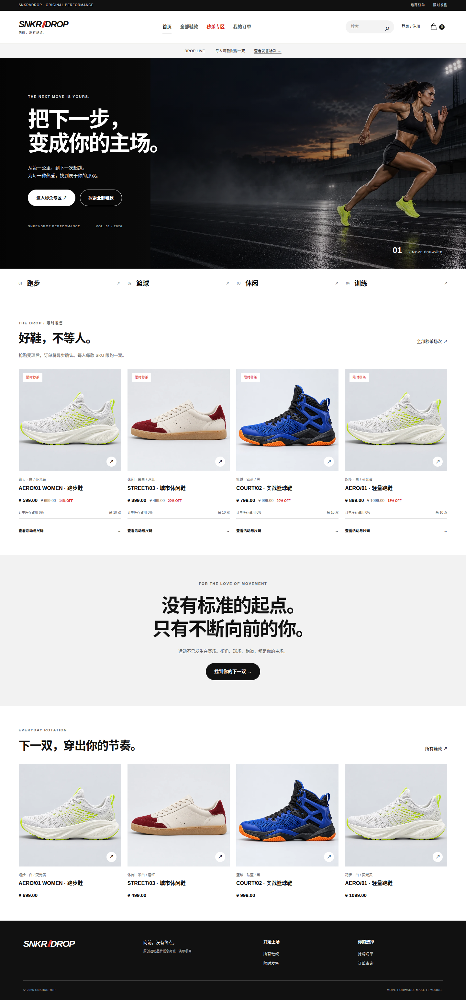

# SNKR//DROP · 运动鞋秒杀商城

Vue 3 / TypeScript / Tailwind 前端，C++ 秒杀服务，RocketMQ 官方 C++/Java SDK，Spring Boot 订单服务，Redis Lua 原子预扣、MySQL 事务库存与幂等订单。



支持商品浏览、每码独立库存的真实 SKU 尺码、用户认证、图片验证码抢购、异步订单查询、模拟支付、超时关闭与幂等回补、商品/活动管理。后台可为既有鞋款新增尺码，并按 SKU 单独配置活动；项目使用原创演示品牌和图片，Nike/Adidas 仅作为用户指定的视觉参考。

## 启动（WSL2 / Linux）

安装 Docker Engine 或启用 Docker Desktop 的 WSL 集成，确认 `docker info` 和 `docker compose version` 可用。

```bash
python3 scripts/prepare-deploy.py
bash scripts/stack.sh up
```

浏览器访问 <http://localhost:18080>。管理账号为 `admin`，密码位于本机生成的 `deploy/.env.stack`，请自行保管；它不会提交到仓库。首次构建包含官方 RocketMQ C++ SDK，耗时取决于网络与机器资源。完整配置、持久化和排障见 [部署说明](docs/DEPLOYMENT.md)。

## 秒杀活动时间与重新开场

首次空库启动时，活动时间按运行时生成，从启动前一分钟开始、持续24小时，不依赖上传日期。其他人克隆后按上面的命令启动，即可注册参与。

已有活动到期后，可以新开七天演示场次：

```bash
bash scripts/stack.sh renew-demo
```

仅处理原创演示鞋款，跳过未到期场次，从每码未分配库存中最多划拨10件；保留旧活动、订单与库存账本。库存不足会跳过，不会无限补货。旧项目更新后先执行 `bash scripts/stack.sh build` 更新工具镜像。若曾手动改过管理员密码，需先让本机 `deploy/.env.stack` 中的 `MALL_ADMIN_PASSWORD` 与现有账号一致。不要并行运行开场命令；中断留下READY活动时，在管理后台激活该场次后再重试。

## 导航

- [项目总览与目录](docs/README.md) · [架构](docs/ARCHITECTURE.md) · [API](docs/API.md) · [决策记录](docs/DECISIONS.md)
- [唯一阶段进度记录](docs/PROGRESS.md) · [待办](docs/TODO.md) · [已知问题](docs/BUGS.md)
- [WSL 测试](docs/TESTING.md) · [验收报告](tests/reports/) · [项目 Skill](.agents/skills/seckill-mall/SKILL.md) · [UI Skill](.agents/skills/seckill-mall/UI_Skill.md)

部署面向本机演示，只有 Nginx 绑定回环地址。支付提供者为 MOCK；RocketMQ 单 Broker，未验证高可用。高并发容量指标、对账和完整故障/压测收尾属于 S7，不能把当前功能验收当作生产容量承诺。
