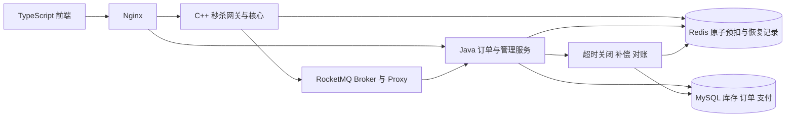
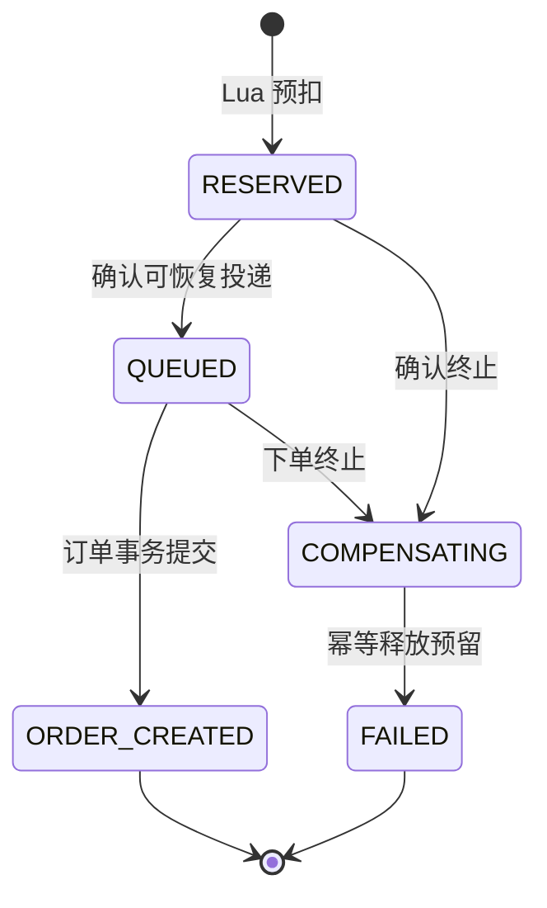
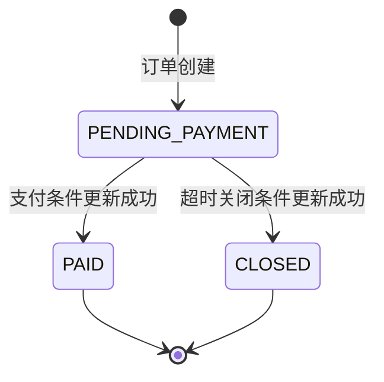

# 架构设计基线

S4设计基线1.4.0。C++HTTP/Redis预扣、RocketMQ传输与Java事务订单/身份/MOCK支付/关闭/outbox/在途恢复已通过WSL验收，容量与生产恢复时延待S7实测。API核心契约保持v1.0.0，MQ/订单取舍见ADR-011/012。

## 服务与数据流

1. 前端展示活动并减少重复点击；Nginx 与 C++ 网关执行服务端限流和身份校验。
2. C++ 服务执行 Lua，原子校验库存、资格并预扣，同时形成可恢复请求记录。
3. pending转发器通过RocketMQ官方C++ SDK投递，保留eventId解决重复投递；用户当前选择见ADR-009。
4. Java 消费者在 MySQL 事务内以唯一约束、条件库存更新创建订单；事务提交后 ACK。
   RocketMQ Proxy消息不可见期配置30秒；PushConsumer自动续租活跃处理，断线未确认消息可在租约到期后重投。WSL单Broker硬停验收见[S13](../tests/reports/S13-acceptance.md)，不代表生产SLA。
5. 用户轮询请求/订单状态，待支付订单可支付或超时关闭；关闭与回补幂等。
6. 对账检查可售、在途预留、未支付占用和已支付占用的守恒，异常通过可审计机制恢复。

## 状态机

请求和订单分别记录，名称与API、SQL、C++枚举统一；状态迁移事务在S4实现。

PAID 与 CLOSED 竞争同一状态迁移；回补完成状态另行记录。投递未知不能直接转失败并回补，迟到支付需独立处置。完整约束见 [一致性约束](../.agents/skills/seckill-mall/references/consistency.md)。

## 库存与数据结构

活动准备事务从SKU的unallocated_stock划拨到activity_stock；本期只售卖活动分配库存，普通购买路径另设计。MySQL available_stock在订单创建扣减，Redis stock在预扣时扣减。库存守恒口径：Redis可售+在途预留+未支付订单占用+已支付占用=活动初始库存；关闭回补归还可售，重复MQ消息不算新占用。

[SQL](../scripts/sql/001_schema.sql)定义用户、商品、SKU、活动、活动库存、请求、订单、支付、outbox和对账表。消费事务采用统一锁顺序：先FOR UPDATE锁定活动库存父记录并校验版本/价格→请求幂等→购买唯一性→库存条件更新→创建订单与ORDER_CREATED outbox→更新请求状态。先插入引用库存的子记录再升级父锁可能形成FK共享锁升级死锁；所有路径保持相同锁顺序，1213/1205有限退避后重试整个事务，任一步失败回滚。支付/关闭仍使用DB条件更新竞争待支付状态与到期时间。

| Redis Key/字段 | 用途 | 生命周期 |
| --- | --- | --- |
| seckill:{activityId:skuId}:ledger | Hash：库存/时间/epoch/价格/ID、pendingCount和durabilityFence | 活动与恢复期不设TTL，归档且对账通过后清理 |
| ledger user:<userId> | reservationId，购买资格占位 | 关闭/失败不释放，直到归档 |
| ledger req:<userId>:<requestId> | 请求状态JSON | 同ledger |
| ledger pending:<reservationId> | 待投递消息JSON | 确认投递/落库或终止后置空墓碑，转发器忽略空值；归档清理 |
| ledger release:<eventId> | 回补去重 | 同ledger |
| seckill:session:<tokenDigest> | Hash：userId/role/expiresAtMs，会话由S4发行 | 目标2小时，注销删除 |
| seckill:limit:ip/user/proof:<digest> | 从首次请求开始的固定窗口计数 | IP/用户1s，验证码签发60s |
| seckill:{activityId:skuId}:challenge:<captchaId> | JSON挑战/双凭证摘要/用户/requestId/epoch绑定 | 固定60s，兑换不延长，错误答案最多5次 |
| seckill:ledgers | 服务访问活动ledger的发现集合 | S3周期扫描、归档清理 |

[reserve.lua](../src/seckill/lua/reserve.lua)以一次HSET写库存、资格、请求、pending及pendingCount；S2 HTTP采用安全模式，两Key同hash tag，凭证与预扣原子校验。S1内部模式仅用于受信存储测试，不向HTTP暴露。单热点集中在一分片，分桶优化须后续实测。

cpp-httplib有界线程池默认8线程/128排队任务，HTTP读写超时3s/body16KiB；线程独享hiredis连接，不跨线程共享context，连接500ms/命令1500ms。队列满时库在解析前关闭TCP，不等同HTTP429；客户端保留requestId查询/重试。默认单活动pending上限10000，Lua原子背压，确认发布/终止时原子降低计数。无库存/资格覆盖恢复行为。

验证码支持随机6位PNG与屏幕阅读器可读取的随机加法题两种模式；答案摘要存Redis，身份来自Redis会话。二者都是基础防刷，不宣称能抵御OCR/自动化求解。IP取socket对端而非XFF，S6需实现明确可信代理策略。Lua原子隔离不等于运行时错误自动回滚，依据[Redis Lua](https://redis.io/docs/latest/develop/programmability/eval-intro/)，专用命名空间与noeviction仍是前提。

## 消息与故障协议

消息采用UTF-8 JSON，[schema](contracts/reserved-event.schema.json)与[示例](contracts/reserved-event.example.json)定义字段。eventId=reservationId，schemaVersion=1，quantity=1，ID/金额/UTC毫秒为字符串。主Topic`seckill_reserved_v1`为NORMAL/4队列，C++消息Key包含eventId与活动/SKU供索引，不要求整个Topic或同SKU严格顺序。Broker/Proxy与SDK实测及版本见[MQ说明](ROCKETMQ.md)。生产适配边界在src/mq/include/mall/mq/publisher.hpp；Receipt不是业务ID。旧[自研协议](contracts/mq-wire.md)延期，库存正确性依赖Lua/DB约束。

1. Redis AOF+always+noeviction。Lua成功后同连接写固定durabilityFence字段再WAITAOF 1 0 1000；读式重放也写屏障，保证本连接确认偏移因果包含此前预扣，不把新连接的空写偏移当作旧请求确认。未达边界503 ACCEPTANCE_UNKNOWN不回补；TCP代理丢弃确认回复的实测证明原ID重试只扣1次。保证仍限本地磁盘健存的进程恢复，见[WAITAOF](https://redis.io/docs/latest/commands/waitaof/)。
2. 转发器有界HSCAN非空pending，通过Publisher投递RocketMQ；Broker刷盘与复制确认配置在S3集成时验证。确认后按eventId置空pending并推进状态；未知不回补，重复投递按reservationId幂等，不能将终态回退QUEUED。SYNC_FLUSH单Broker只验证本地磁盘健存边界，不称HA。

PendingRelay::drain及`mall_relay_worker`已接官方C++ SDK；`--loop`持续发现`seckill:ledgers`，每批至多1000次发布尝试，unknown/rejected保留pending并退避，confirmed才调用Lua推进QUEUED/清理计数。测试probe只允许s2_test_命名空间，不在HTTP/发布运行时使用。Broker停机后原worker可在恢复时自动重试；发送确认后进程退出造成重复消息时业务eventId不变。Redis状态若先被下游推进到ORDER_CREATED，确认回写只清除pending而不倒退状态。
3. S3的Java探针用于传输验收；S4真实订单消费者使用PushConsumer，核对Redis预扣来源及DB快照，MySQL事务提交后返回SUCCESS，否则返回FAILURE。重复投递保留eventId并通过DB唯一键去重；COMPENSATING/FAILED的请求不复活。官方SDK管理消费确认。
4. Broker对订单组`mall_order_v1`配置8次递增重试；测试组max=1时已观察PushConsumer失败回调、重投与DLQ。S4/S7必须处理DLQ/终止/补偿/对账，死信不能盲目回补，迟到消费者必须识别FAILED。RocketMQ事务消息不能把Redis与MySQL组成原子事务。
5. 订单15分钟过期，由DB持久化索引扫描关闭，不依赖MQ延迟插件。关闭事务归还MySQL库存并写唯一RESERVATION_RELEASE outbox；Redis按epoch/reservationId/eventId原子回补去重。未创建订单失败只归还Redis预留。补偿成功后才完成outbox投递记录，结果未知用原ID重试。
6. MQ丢失或确认未知：暂停新接单，按Redis请求与DB订单/请求重发缺失事件，重复安全。Redis磁盘丢失：暂停活动，核对DB与存活MQ后恢复；未持久化事实缺口需告警/人工处理，禁止盲重置库存。MySQL宕机保持排队与背压；恢复后按约定窗口对账。

S4恢复实现：消费错误写mq_failures供管理审计/保留原身份重放；即使DB宕机期间消息进入DLQ且无法写审计，Redis在途请求仍可扫描。默认30分钟仍未创建订单的请求在库存父锁内写COMPENSATING终止记录和回补outbox，阻止迟到消费者建单；Redis Lua经同连接WAITAOF确认后DB转FAILED。已创建订单以DB状态为准，PAID永不回补。每轮任务有界并保持Redis扫描游标，运行与具体限制见[订单说明](ORDER-RUNTIME.md)。完整告警/库存对账仍在S7。

## 部署和压测计划

数据基础设施见[Compose](../deploy/compose.infra.yml)，MQ开发环境见[Compose](../deploy/compose.mq.yml)。S3的`SYNC_FLUSH + ASYNC_MASTER`仍是单Broker本地持久化，`SIGKILL`恢复依赖持久卷；未验证多副本HA。S6补服务Dockerfile/Nginx/全链路Compose/就绪重试/持久化卷，并修正Broker在容器网络中广播的地址，按基础设施→迁移预热→MQ→订单→秒杀→接入前端启动。

S1库存脚本首次初始化只写空Key，data.py只允许READY且尚无DB请求的活动预热，不用available_stock直接重建运行中缓存。回补先验证epoch/reservationId和DB终止/关闭证据，再执行单HSET；保留资格、eventId与reservation级去重，PAID不可被本地状态镜像关闭。mark_order仅镜像已提交DB状态，禁止向公网暴露。

S7覆盖单热点、多活动、突发、持续及下游故障；入口、拒绝、预扣QPS和落库TPS分开报告，记录端到端P95/P99、积压年龄、重试/死信、回补与对账。容量/硬件指标待实测确定，不能以售罄拒绝QPS证明订单吞吐。

## S5 客户端与开发接入

Vue 3/TypeScript 实现拾间概念商城，`App.vue` 负责 hash 页面、认证/验证码、商品、请求与订单状态；`Admin.vue` 管理真实业务；`api.ts` 集中 DTO、请求错误、金额和持久请求标识；`style.css` 共用响应式设计 token。原创图片在 public/assets，商品仍由 MySQL 管理接口创建并读取，接口失败不伪造可购买商品。

开发/本地展厅的浏览器 → 同源 Vite proxy → `/api/seckill` C++，其余 `/api` Java。C++预扣 → relay → RocketMQ → Java/MySQL/outbox 的链路保持不变。客户端sessionStorage保存会话，localStorage按用户记录稳定请求ID和支付键。查询从500ms退避到3秒，120秒暂停，切页取消；无未知结果自动回补逻辑。生产静态服务和TLS/Nginx在S6。

本地展厅通过随机专有 DB/缓存/Topic 隔离，真实服务子进程由 Python supervisor 管理；启动及清理边界见 FRONTEND-RUNTIME，不代表完整容器部署或容量验收。

## V009 运动主题修订

用户指定UI_Skill与UI六张参考图，原家居主题替换为SNKR//DROP运动鞋主题。ShopFront（首页/目录/秒杀）、ShoeCard、ShoeDetail、ShoppingBag与App状态协调分工，Tailwind4.1.14+主题CSS；原有异步交易链路不变。后台SKU属性由003迁移支持，在活动库存父记录锁下拒绝已分配SKU的规格修改，避免与createActivity并发重写。就绪同时检查002/003。

S12补充验证码`mode=accessible`：C++生成随机两位数加法题、只保存答案SHA256，前端将题目置于aria-live状态区域并可与图片模式切换；题目保持一次性、60秒过期、最多5次错误限制。端到端浏览器测试通过真实订单链路验证替代模式，不把答案放入响应。

画廊第二视图为原图局部，尺寸来自真实SKU。清单按用户分区持久化，仅选款、不锁库存/合单；逐款验证码受理→订单→MOCK支付。详情/场次展示规则、参考图分析和组件树见FRONTEND-DIRECTION，V009真实浏览器/SQL验收与显式页面响应注入分开记录。

## S6 容器部署

S7引入独立只读对账程序：MySQL一致性快照与版本复查、Redis前后账本快照，按未释放唯一预留/未关闭订单解释差额，并检查pending发送、持久outbox及消费失败。变化中的快照返回INCONCLUSIVE，依赖不可达返回UNAVAILABLE，不执行重置/库存修复；明细见[OPERATIONS](OPERATIONS.md)。C++请求开始用可安全重试的PING刷新线程旧连接，实际变更命令不自动重试。

浏览器 → 回环地址 Nginx → C++ 秒杀 / Java 业务 → Redis、MySQL；C++ relay 经 Broker Proxy 投递，Java 官方 SDK 消费。所有业务容器在独立 backend bridge 内，只有 Nginx 发布宿主端口。Dockerfile 从源码构建并保留 Linux ABI；C++/Java 使用 UID10001，Lua 随镜像分发。

首次启动一次性服务负责持久化卷权限、RocketMQ topic/消费组、校验式增量 SQL 迁移；随后按真实就绪检查启动业务。种子只对空商品库执行，不改写既有订单/库存。Redis AOF、MySQL、Broker store 和日志使用命名卷。Nginx 使用 Docker DNS 解析服务重建后的地址，不自动重试交易请求。

代理覆盖用户转发头，C++仅信任精确 MALL_TRUSTED_PROXY IP，Java Tomcat 仅信任精确 ORDER_TRUSTED_PROXY_REGEX；直连默认不信任转发头。详细操作与网络配置见 [DEPLOYMENT](DEPLOYMENT.md)。单 Broker、本机 HTTP 和 MOCK 支付的边界保留，容量/恢复 SLA 属于 S7。
