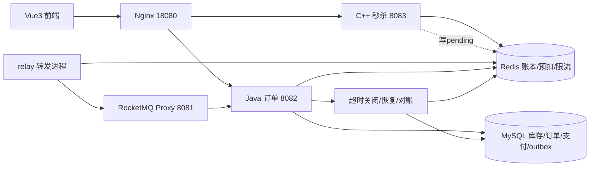
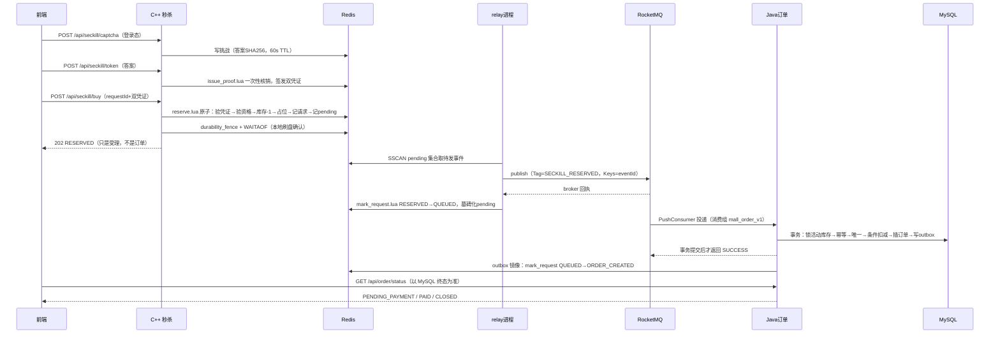
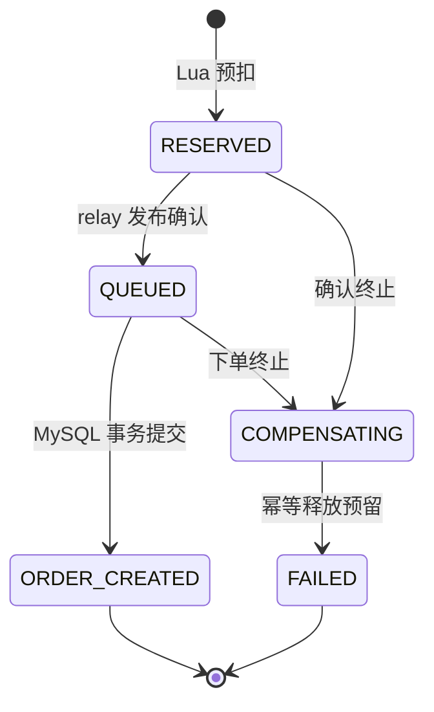
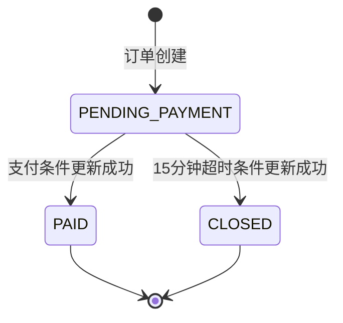

# 项目实现说明（GUIDE）

本文面向想快速读懂项目的人：说明商城有哪些功能、整体怎么搭起来、页面怎么做、接口怎么做、防超卖怎么保证、各模块关键函数做什么、一次抢购的完整工作流程。内容全部来自当前代码与已验收文档，属于“讲解性汇总”；权威契约与进度以 [API](API.md)、[ARCHITECTURE](ARCHITECTURE.md)、[PROGRESS](PROGRESS.md) 为准，本文不新增任何契约。本版于 2026-10-19 更新，覆盖 S17 容量修复、S18 门禁自动化与 S19 混合旅程验收；S20 突发复核（T053）进行中，相关结论见第 13 章。

阅读顺序建议：先看第 1、2、4 章建立整体印象，再按兴趣跳到第 5（页面）、6（接口）、7（防超卖）章，函数清单（第 10 章）当字典用。

---

## 1. 商城功能一览

**前台（顾客）**

| 功能 | 说明 |
| --- | --- |
| 首页 / 全部鞋款 | 主视觉、分类入口、限时发售卡片；目录支持服务端搜索、运动场景/价格筛选、排序、0 起始分页（默认 12、最大 48） |
| 商品详情 | 图库两视图（侧面/细节 + 放大）、配色、真实 EU 尺码按钮（每个尺码是独立 SKU、独立库存）、活动价格与倒计时 |
| 秒杀场次 | 按“全部/已开启/即将开抢/已结束”筛选活动，展示起止时间与订单占用进度 |
| 用户注册 / 登录 | 注册即 USER 角色；会话令牌存 Redis，2 小时过期；密码 BCrypt |
| 图片验证码抢购 | 6 位数字 PNG 与屏幕阅读器可读的加法文字题两种模式；答案只存 SHA256 |
| 抢购（秒杀） | 验证码 → 兑换双凭证 → `buy` 预扣 → 异步下单 → 轮询结果；网络中断可用同一 requestId 继续查 |
| 抢购清单 | 纯前端 localStorage 记录，数量固定 1，**不锁库存**；逐款走验证码抢购流程 |
| 我的订单 / 结果页 | 请求状态与订单状态轮询（500ms 起退避到 3s，120s 暂停）、模拟支付按钮、支付截止时间 |
| 模拟（MOCK）支付 | 幂等键防重复支付；15 分钟未支付自动关闭并回补库存 |

**后台（ADMIN）**

| 功能 | 说明 |
| --- | --- |
| 商品管理 | 新建鞋款（首 SKU）、编辑、上下架 |
| 尺码 SKU 管理 | 给既有鞋款新增 EU 35–50（含半码）尺码，继承价格/类别/配色，拒绝同款重复尺码；维护展示属性 |
| 活动管理 | 创建活动并从 SKU 未分配库存划拨、开启（activate）、结束（end）；每个尺码 SKU 单独建活动 |
| 用户管理 | 列表、启用/禁用（禁用即吊销会话，不能禁用自己） |
| 订单管理 | 全站订单列表 |
| 换复处理 | 消费失败消息（`mq_failures`）查看、单条重放、手动执行一轮关闭/outbox/恢复任务 |
| 指标 | C++ `/metrics`（Prometheus 文本，ADMIN 必需）；Java `/api/admin/recovery` 指标卡片 |

**平台能力**：健康检查（live/ready）、限流与黑名单、幂等重放、超时关闭与幂等回补、outbox 可靠投递、消费失败审计与重放、只读库存对账、Docker Compose 一键部署、WSL/Linux 测试入口。

---

## 2. 总体架构

### 2.1 技术栈与模块职责

| 模块 | 目录 | 技术 | 职责 |
| --- | --- | --- | --- |
| 前端 | `src/web/` | Vue 3 + TypeScript + Tailwind 4 + Vite | 页面、hash 路由、会话/清单/轮询、验证码与抢购交互 |
| 秒杀核心 | `src/seckill/` | C++17（cpp-httplib + hiredis + libpng + OpenSSL） | HTTP 网关、限流、鉴权、验证码、Redis Lua 原子预扣、刷盘确认 |
| 消息适配 | `src/mq/` | 官方 RocketMQ C++ SDK | 独立转发进程：扫描 pending → 发 RocketMQ → 回写状态 |
| 订单服务 | `src/order/` | Java 21 + Spring Boot + JdbcTemplate + Lettuce | 账号、商品/活动管理、MySQL 事务下单、MOCK 支付、超时关闭、outbox、恢复与对账入口 |
| 存储 | 容器 | Redis 7.2（AOF always、noeviction）/ MySQL 8.4 | 预扣账本与限流 / 权威业务数据 |
| 消息 | 容器 | RocketMQ 5.3.2（NameServer + Broker 内嵌 gRPC Proxy） | 预扣事件异步传输 |
| 接入 | `deploy/` | Nginx + Docker Compose | 静态资源、API 分流、限流、可信代理 |

### 2.2 服务与端口

| 服务 | 端口 | 说明 |
| --- | --- | --- |
| Nginx 网关 | `127.0.0.1:18080` | **唯一对外端口**；`/api/seckill/*` → C++，其余 `/api/*` → Java |
| C++ 秒杀 | 8083（容器内） | 开发本机 `127.0.0.1:8083` |
| Java 订单 | 8082（容器内） | 开发本机 `127.0.0.1:8082` |
| RocketMQ Proxy | 8081（gRPC） | C++/Java 官方 SDK 都连它 |
| Redis / MySQL | 6379 / 3306 | 仅容器内网；开发用 `compose.infra.yml` 可映射本机 |
| Vite 开发服务器 | 5173（`MALL_WEB_PORT` 可改） | 同源代理：`/api/seckill` → 8083，`/api` → 8082 |

### 2.3 数据流



一句话链路：**前端 → Nginx → C++ 在 Redis 上原子预扣（写入待发事件）→ relay 进程把待发事件投给 RocketMQ → Java 消费者在 MySQL 事务里创建订单并写 outbox → outbox 再把终态镜像回 Redis → 前端轮询拿到订单结果**。

### 2.4 目录结构

```text
seckill-mall/
├── src/seckill/          C++ 秒杀服务（main/service/relay/redis/captcha + lua/）
├── src/mq/               RocketMQ 转发进程与 Publisher 抽象
├── src/order/            Spring Boot 订单服务（business/、messaging/）
├── src/web/              Vue3 前端（App.vue 根组件 + 页面组件 + api.ts）
├── deploy/               compose、Dockerfile×4、nginx、rocketmq 配置
├── scripts/              stack.sh、data.py、migrate/seed/对账、test-*.sh 测试入口
├── tests/                业务/集成/负载测试与 reports/ 验收报告
├── docs/                 架构、API、进度、决策、本说明
└── .agents/skills/seckill-mall/  项目 skill（约束与验收规则）
```

---

## 3. 实现过程（阶段演进）

项目按阶段串行推进，每阶段“有代码 + 有命令 + 有验收证据”才算完成（真相源：[PROGRESS](PROGRESS.md)）。

| 阶段 | 交付内容 |
| --- | --- |
| S0 骨架 | 四个子工程目录、核心契约（状态枚举、消息 schema、错误码）、构建与静态契约检查 |
| S1 数据与缓存 | MySQL 迁移工具（`001/002/003`）、Redis 预热、AOF 崩溃恢复测试 |
| S2 C++ 秒杀服务 | HTTP 接口、限流、验证码、双凭证、`reserve.lua` 原子预扣、`durability_fence` 刷盘屏障 |
| S3 RocketMQ 集成 | 官方 C++ SDK 接入、`mall_relay_worker` 转发进程、pending→QUEUED、重试/DLQ 验证 |
| S4 Java 订单 | 注册登录会话、商品/活动管理、消费事务下单、MOCK 支付、15 分钟超时关闭、outbox 与恢复 |
| S5 前端 | Vue3 商城页面、抢购流程、订单/支付页、管理后台（原家居主题 → V009 运动鞋主题） |
| S6 部署 | 四个 Dockerfile、完整 Compose、Nginx 分流与可信代理、干净卷验收、公开仓库 |
| S7 验证收尾 | 故障恢复/DLQ/限流/容量场景，976 笔订单持久化且只读对账 CLEAN |
| S8 消费者优雅恢复 | consumer 关闭等待 20s 与容器宽限匹配，重启后订单 11–15 秒可查 |
| S9 目录分页 | `GET /api/goods/catalog` 服务端搜索/筛选/排序/分页 |
| S10 图片优化 | 原创 PNG → WebP（8.49MB → 0.43MB，−94.9%） |
| S11/S13 强停恢复 | 定位 RocketMQ 60s 消息不可见期，`defaultInvisibleTimeMills=30000` 后强停恢复 8.5–52.8s |
| S12 无障碍验证码 | `mode=accessible` 加法文字题，答案仅存 SHA256 |
| S14 线程容量诊断 | C++ 工作线程 8–64 扫描；入口改善，订单可查 P95 仍超 3 秒 |
| S15 多尺码 SKU | 每个尺码独立 SKU/独立库存/独立活动，管理端可增删规格 |
| S16 持续容量诊断 | 15 QPS×30 分钟两轮未达标；分段遥测把问题指向入口读放大、空闲连接与调度阻塞，而非预想的热行锁 |
| S17 持续容量修复 | 修复活动全账本读放大（固定 9 字段 HMGET）、Nginx 空闲连接占满工作池（每响应关闭后端连接）、冗余往返；outbox 派发移到独立单线程调度器。**本机专项容量门禁首次通过**：27,000/27,000 HTTP202、5xx 0、buy P95 159ms、订单可查 P95 1188ms |
| S18 容量门禁自动化 | 独立校验器 `check_capacity_gate.py` + WSL 一键入口；门禁不信任自报"通过"，独立核对计数/时长/延迟/库存守恒，短测与历史失败报告会被拒绝 |
| S19 混合用户旅程与突发 | 27,000 次背景读/30 分钟 + 64 条完整旅程（真实登录/验证码/token/抢购/MOCK 支付/自然 15 分钟关闭），buy P95 69ms、订单可查 P95 318ms；64 人突发零超卖，五场对账 CLEAN |

---

## 4. 端到端工作流程

### 4.1 用户视角的一次购物

1. 打开首页 → `GET /api/goods` + `GET /api/activities` + `GET /api/goods/catalog` 拉取商品、活动、分页目录。
2. 进入商品详情 `#/product/{goodsId}/{skuId}` → `GET /api/goods/{id}` 拿全部尺码 SKU，`GET /api/seckill/info` 拿活动状态与**服务器时间**（前端用 `serverTimeMs - Date.now()` 校准倒计时）。
3. 点“立即抢购” → 未登录先弹登录框（成功后跳回原路由）；已登录则复用/生成 `requestId` 并写入本地记录。
4. 弹验证码对话框 → `GET /api/seckill/captcha`（可换一张、可在图片/文字题之间切换、60 秒失效倒计时）。
5. 提交答案 → `POST /api/seckill/token` 兑换 `captchaToken` + `activityToken`（**同时把 requestId 标记为已提交**）→ `POST /api/seckill/buy`。
6. 成功返回 202（受理）→ 跳 `#/request/{requestId}` 轮询 `GET /api/order/status`。
7. 拿到 `orderId` 自动跳 `#/order/{orderId}` 继续轮询；`PENDING_PAYMENT` 时出现“模拟支付”按钮 → `POST /api/order/pay`（幂等键）。
8. 支付成功 `PAID`，或 15 分钟未支付被 `CLOSED` 并回补库存 → 轮询停止。
9. 全程若网络中断：**不换 requestId 重试**，用同一 ID 查询；“我的订单”页底部有“抢购请求”列表可继续查。

### 4.2 系统内部的下单链路



要点：

- **202 只代表“预扣已落盘”**，不是订单成功；前端文案与轮询逻辑都按这个语义实现。
- relay 是独立进程（`mall_relay_worker --loop`），C++ HTTP 服务本身不连 RocketMQ（`/health/ready` 里 `mqIntegrated:false` 就是这个意思）。
- Java 只有在 **MySQL 事务提交成功后**才 ACK；失败返回 FAILURE 进入重试/死信。

### 4.3 支付、超时关闭与回补

- 支付：`POST /api/order/pay` 在事务里 锁库存行 → 锁订单行 → 条件更新（必须 `PENDING_PAYMENT` 且未过 `expiresAtMs`）→ 插 `payments`（幂等键唯一）→ 写 `ORDER_PAID` outbox。已关闭/已过期返回 409 `ORDER_CLOSED`；已支付换幂等键也不会产生第二笔支付。
- 超时：`order-recovery` 单线程调度器周期执行 `Orders.closeExpired()`，扫 `ix_timeout(status, expires_at_ms)`，把到期订单条件更新为 `CLOSED`、MySQL `available_stock+1`、写 `RESERVATION_RELEASE` outbox。
- 回补：outbox 事件由独立的 `order-outbox` 单线程调度器派发（S17 起与超时/恢复扫描隔离，逐事件事务锁定并重查 PENDING），经 `Orders.mirror()` 调 `release.lua`，在 Redis 按 `eventId` 去重后 `stock+1`，**但保留 `user:` 资格占位（关闭不释放“已购”标记）**。

### 4.4 后台管理流程

管理员在 `#/admin` 五个 Tab（商品/活动/用户/订单/恢复）里操作，全部走 `/api/admin/*`：

1. 新建鞋款或给既有鞋款加尺码 → `POST /api/admin/goods`、`POST /api/admin/goods/{id}/skus`（锁父 `goods` 行、拒绝重复尺码）。
2. 创建活动 → `POST /api/admin/activities`：从 `unallocated_stock` 条件划拨到 `activity_stock`，状态 `READY`。
3. 开启活动 → `POST /api/admin/activities/{id}/activate`：事务内 Lua `preload` 预热 Redis 账本 → 校验五字段一致 → DB 置 `ACTIVE`，**提交后**才把 Redis 置 `ACTIVE`（保证买家可见时 DB 已就绪）。
4. 结束活动 → `/end`：先停 DB 再停 Redis，停止新购买但已受理消息继续处理。
5. 出问题时 → `/api/admin/recovery` 查看消费失败与指标，`/{hash}/replay` 单条重放，`/run` 手动触发一轮恢复。

---

## 5. 页面是如何实现的

### 5.1 骨架与路由

- `src/web/src/main.ts` 只有 `createApp(App).mount('#app')`：**没有 vue-router、没有 Pinia**，路由和全局状态都由根组件 `App.vue`（约 35KB）自实现。
- 路由：`route = ref(decodeRoute())`，监听 `hashchange`；`page = route.split('/')[1]`，`id = route.split('/')[2]`，第三段用于 SKU 变体。切页时 `loadPage()` 会停轮询、按页加载数据、`nextTick` 后聚焦 `main h1` 并滚顶（可访问性）。
- `vite.config.ts` 做同源代理：`/api/seckill` → C++ 8083，其余 `/api` → Java 8082（与生产 Nginx 规则一致）。

| hash 路由 | 渲染位置 | 数据 |
| --- | --- | --- |
| `#/` | `ShopFront page="home"` | `loadCatalog()` |
| `#/catalog`、`#/catalog/{分类}` | `ShopFront page="catalog"` | `fetchCatalog()` 服务端分页 |
| `#/flash` | `ShopFront page="flash"` | 复用 `activities` |
| `#/product/{goodsId}/{skuId}` | `ShoeDetail` | `GET /api/goods/{id}` + `GET /api/seckill/info` |
| `#/cart` | App 内嵌“抢购清单” | 本地 `bagIds` |
| `#/orders` | App 内嵌“我的订单” | `GET /api/orders` + 本地 attempts |
| `#/request/{requestId}`、`#/order/{orderId}` | App 内嵌结果页 + 轮询 | `GET /api/order/status` |
| `#/admin` | `Admin`（仅 ADMIN） | `/api/admin/*` |
| 其它 | 内嵌“页面未找到/需要管理员账号” | — |

### 5.2 全局状态与持久化

状态全部集中在 `App.vue` 的 `ref/computed`，通过 props/emits 下发子组件：

- **会话**：`session` → `sessionStorage["shijian.session"]`（token 必须是 64 位 hex 才接受）；`api()` 收到 401 会派发 `mall-session-expired` 事件，App 统一清理并提示重新登录。
- **商品/活动/目录**：`goods`、`activities`、`catalogItems/Total/Page/HasMore`；`catalogRequest` 自增序号丢弃过期响应（防止快速翻页串数据）。
- **时钟**：`clock`（1 秒 ticker）+ `offset`（来自 `/api/seckill/info` 的服务器时间差），所有倒计时、验证码过期、`canBuy` 判断都用 `clock + offset`，不受本地时钟影响。
- **localStorage**（按 userId 分区，切账号不串）：
  - `snkr.bag.{userId|guest}` — 抢购清单 SKU 列表；
  - `shijian.attempts.{userId}` — 抢购请求记录 `{activityId, skuId, requestId, submitted}`，按活动+SKU 去重；
  - `shijian.pay.{userId}.{orderId}` — 支付幂等键（首次 `crypto.randomUUID()` 后长期复用）。
- **轮询控制**：`generation` 代际号 + `AbortController` + `setTimeout`，切页/卸载即失效；401 停止并清会话。

### 5.3 页面组件分工

| 组件 | 职责 | 是否直接调接口 |
| --- | --- | --- |
| `App.vue` | 公共壳（顶栏/导航/搜索/公告/页脚）、路由、登录注册对话框、验证码对话框、抢购流程、轮询与支付、清单与订单内嵌页 | 是（几乎全部接口） |
| `ShopFront.vue` | 三合一：首页 hero+分类+卡片网格；目录页左侧筛选栏+右侧结果+加载更多；秒杀页场次 Tab+进度 | 否，靠 props/emits |
| `ShoeCard.vue` | 商品卡片：图、标签、活动价/原价/折扣、订单占用 `<progress>` | 否 |
| `ShoeDetail.vue` | 详情：图库两视图+放大、尺码网格（来自真实 SKU）、活动块与倒计时、抢购/加入清单按钮 | 否（`buy/refresh/save` 回到 App） |
| `ShoppingBag.vue` | 原生 `<dialog>` 右侧抽屉，文案明确“清单仅保存鞋款选择，不预留库存” | 否 |
| `Admin.vue` | 后台五 Tab 与全部管理表单 | 是（`/api/admin/*`） |

`api.ts` 是前端与后端的唯一通道：`api<T>()` 统一 fetch（Bearer 头、错误解析成 `ApiError{code,status,retryable}`、401 事件）、`money()` 用 BigInt 把分转元、`message()` 把业务码翻成中文提示、`attempts()/remember()`、`paymentKey()` 管幂等键、`readSession()/saveSession()` 管会话。

### 5.4 抢购交互（前端逐步）

1. `startPurchase()`：校验登录/活动状态/已选尺码 → 查本地 attempts，有同活动+SKU 记录就**复用其 requestId**，否则 `crypto.randomUUID()` 新建并落盘。
2. 若记录已 `submitted=true`（上次提交过）→ 直接跳结果页轮询，不再走验证码。
3. 否则打开验证码对话框 `refreshCaptcha(mode)`，显示失效倒计时，支持换图/切换文字题。
4. `buy()`：先 `POST /api/seckill/token`，成功即 `submitted=true` 落盘；再 `POST /api/seckill/buy`。
   - 成功 → 跳 `#/request/{requestId}`；
   - **网络错误/5xx/非 ApiError → 视为“受理结果未知”，直接按原 requestId 去查询，不判失败、不换 ID 重试**；
   - 明确 4xx 业务失败 → `submitted` 回滚为 false，提示 `message(e)` 并要求重新验证。
5. `poll()`：500ms 起 ×1.3 退避到 3s（`PENDING_PAYMENT` 固定 3s），120 秒暂停并提示；`PAID/CLOSED/FAILED` 终态停止；拿到 orderId 从 request 页跳 order 页。
6. `pay()`：`POST /api/order/pay` 带持久化幂等键，成功/失败都 `retryPoll()` 以 MySQL 权威状态为准。

### 5.5 样式体系

- `sports.css`（第 1 行 `@import "tailwindcss"`，Tailwind 4 入口）：当前运动主题。设计 token（`--color-accent:#d62820` 秒杀红、`--green:#111`、无外网字体）、`.sports-hero/.product-grid/.size-grid/.countdown/.bag-drawer` 等区块类、断点 1280/1024/768/640 与 `prefers-reduced-motion`。
- `style.css`：与主题无关的通用层（表单、对话框、订单行、管理表格、结果页、无障碍 focus-visible/skip 链接），被 `sports.css` 同名类覆盖。
- 规范见 [FRONTEND-DIRECTION](FRONTEND-DIRECTION.md)：首页手机 2 列/平板 3 列/桌面 4 列；图片在 `public/assets/*.webp`（源 PNG 归档在 `assets-source/`）。

---

## 6. 接口是如何实现的

### 6.1 请求怎么被分流

```
浏览器 ──► Nginx(18080)
             ├─ location ^~ /api/seckill/ ──► C++ seckill:8083
             ├─ location /api/            ──► Java order:8082   （含 /api/order/*）
             ├─ /health/live | /health/order | /health/seckill
             └─ 其余 ──► 静态资源（SPA try_files）
```

Nginx 覆盖客户端转发头，C++ 只信任精确 `MALL_TRUSTED_PROXY` IP，Java Tomcat 只信任 `ORDER_TRUSTED_PROXY_REGEX`；请求体上限 16KiB（超限 413）；`limit_req` 每 IP 40r/s（超限 429）；交易请求 `proxy_next_upstream` 关闭（不自动重试）。

### 6.2 所有接口的统一约定

- **鉴权**：`Authorization: Bearer <64位hex>` → Redis `seckill:session:<SHA256(token)>`（userId/role/expiresAtMs，2 小时 TTL）。身份永远来自服务端会话，禁止客户端指定 userId。
- **错误格式**：`{"code","message","traceId","retryable"}`；`retryable = status>=500 || 429`；429/503 可带 `Retry-After`。
- **wire 规则**：ID/金额分/UTC 毫秒一律十进制字符串；JSON 未知字段、重复字段、重复查询键一律 400；body ≤16KiB。
- **幂等键**：`requestId`（抢购）、`idempotencyKey`（支付）、`eventId=reservationId`（消息）。

### 6.3 C++ 侧接口怎么实现（`src/seckill/service.cpp`）

每个路由都套在 `wrap(handler)` 中间件里：计数 → 生成 `X-Trace-Id` → Redis `PING` 探测（唯一允许重试的操作）→ 解析可信代理 IP → IP 黑名单/限流 → 统一异常转 JSON → 打一行 `{traceId,path,status,rtUs}` 日志。

| 路由 | 处理步骤 |
| --- | --- |
| `GET /health/live` | 直接返回 UP |
| `GET /health/ready` | 检查 Redis `appendonly=yes`、`appendfsync=always`、`noeviction`，否则 503 `NOT_READY` |
| `GET /api/seckill/info` | `auth` 可选 → `HGETALL` 账本 → 服务器时间判断 `ENDED` → 返回活动状态与 `stockAvailable` |
| `GET /api/seckill/captcha` | `auth` → 活动存在 → 60 秒 5 次签发限流 → `create_captcha()`/`create_accessible_captcha()` → 写 `challenge:<captchaId>`（含答案 SHA256、attempts、60s TTL） |
| `POST /api/seckill/token` | `auth` → body 精确 5 字段 → 生成 `captchaToken`/`activityToken` → `issue_proof.lua` 核销答案（错一次 `attempts+1`，最多 5 次；对则 `used=true` 并绑定 user/requestId/epoch/两个摘要） |
| `POST /api/seckill/buy` | `auth` → **先查 `req:<user>:<requestId>` 命中即幂等重放返回 200** → 校验双凭证格式 → `reserve.lua`（4 KEYS 同 hash tag）→ `RESERVED` 则 `durability_fence`+WAITAOF 后 **202**；Redis 结果未知 → **503 `ACCEPTANCE_UNKNOWN`（不回补，按原 ID 查）** |
| `GET /api/order/status` | `auth` → 读 `req:` 字段返回在途状态；`ORDER_CREATED`/`orderId` 查询在 C++ 返回 503（部署时该路径被 Nginx 交给 Java，以 MySQL 为准） |
| `GET /metrics` | `auth` 且 ADMIN → Prometheus 文本（requests/errors/reserved/accepted/acceptance_unknown/replay/rate_limited/duration） |

关键辅助函数：`auth()`（会话+黑名单+用户限流）、`limit()`（调 `rate_limit.lua`）、`activity()`（账本字段完整性校验 → 404/503）、`body()/query_keys()`（严格入参，拒绝重复/未知字段）、`durability_fence()`（同连接 `HSET durabilityFence` 写因果屏障 + `WAITAOF 1 0 1000`，未确认即 503）。

### 6.4 Java 侧接口怎么实现（`src/order/.../business/Api.java`）

- 每个 handler 是 `Api` 里的一个方法，读 `Authorization` 经 `Sessions.auth()` 得到 `Identity`，写操作经 `Input` 严格校验（未知/重复字段 400），DB 操作走 `Store`（`transaction()` 瞬态异常最多 3 次退避重试；时间一律 `Store.now()` 取 MySQL UTC 毫秒）。
- 异常统一由 `Errors`（`@RestControllerAdvice`）转成标准错误体：`Fault` → 自带状态/码，`DuplicateKeyException` → 409，数据访问/Redis 异常 → 503，其余 → 500。

| 分组 | 接口 | 实现要点 |
| --- | --- | --- |
| 认证 | `POST /api/auth/register`、`/login`、`GET /me`、`POST /logout` | 注册限流 15 次/10 分钟/IP；登录双限流 + BCrypt + 生成 token 写 Redis 会话；登录失败统一 401 |
| 商品 | `GET /api/goods`、`GET /api/goods/{id}`、`GET /api/goods/catalog` | `Catalog`：JOIN 查询；分页版 `productPage` 支持 q/category/maxPriceFen/sort/page/size，`MIN(sku)` 按商品去重，排序稳定（价格相同按商品 ID 倒序） |
| 活动 | `GET /api/activities` | 返回 READY/ACTIVE/ENDED 及 SKU、时间、价格、DB 展示库存 |
| 订单 | `GET /api/orders`、`GET /api/order/status`、`POST /api/order/pay` | `Orders.query()` DB LEFT JOIN 优先，DB 无记录才回落 Redis 在途状态；`pay()` 锁序 stock→orders→payments，条件置 PAID + 插 payments + outbox |
| 管理 | `/api/admin/goods`（增改查）、`/goods/{id}/skus`、`/skus/{id}`、`/activities`（增/activate/end）、`/users`、`/orders`、`/recovery*` | 创建尺码锁父 goods 行拒绝重复尺码；activate 在事务内 preload Redis 并做五字段一致性校验（不一致 409 `CACHE_CONFLICT`） |
| 健康 | `/health/live`、`/health/ready` | ready 检查迁移齐备、MySQL 查询、消费者初始化、Redis AOF 配置 |

### 6.5 接口总表

完整契约（请求/响应示例、错误码表）见 [API](API.md)。速查：

- **C++（`/api/seckill/*`）**：`info`、`captcha`、`token`、`buy`。
- **Java**：认证 4 个；`GET goods / goods/{id} / goods/catalog / activities / orders`；`GET order/status`、`POST order/pay`；管理 14 个（商品 3、尺码 2、活动 3、用户 2、订单 1、恢复 3）。
- **稳定错误码**：400 `INVALID_ARGUMENT`；401 `UNAUTHENTICATED`；403 `FORBIDDEN/INVALID_PROOF`；404 `NOT_FOUND`；409 `SOLD_OUT/ALREADY_PURCHASED/NOT_STARTED/ENDED/STALE_EPOCH/REQUEST_CONFLICT/ORDER_CLOSED/SKU_IN_USE/SKU_SIZE_EXISTS/...`；413 `PAYLOAD_TOO_LARGE`；429 `RATE_LIMITED`；503 `NOT_READY/BACKPRESSURE/DEPENDENCY_UNAVAILABLE/ACCEPTANCE_UNKNOWN/ORDER_SERVICE_UNAVAILABLE`。

---

## 7. 防超卖是如何实现的（核心）

“超卖”= 卖出的订单数超过活动库存。项目用**多层互相独立的防线**，任何一层单独失守都不会造成最终超卖。

### 7.1 五层防线总览

```text
第1层  Redis Lua 原子预扣     —— 高并发入口：检查+扣减在同一个原子块，先到先得
第2层  一人一单资格占位        —— 同一用户同一活动+SKU 只能成功一次
第3层  MySQL 条件更新+唯一约束 —— 权威库存与订单的最后闸门（DB 说了算）
第4层  幂等（requestId/唯一键）—— 重试、重复消息不会重复扣减或重复下单
第5层  回补护栏 + 对账         —— 回补永不超过初始库存，事后只读对账兜底
```

### 7.2 第 1 层：`reserve.lua` 原子预扣

Redis 单线程串行执行 Lua，因此“所有检查 + 扣库存 + 占位 + 记请求 + 登记待发消息”发生在**同一个原子块**里，不存在 check-then-act 竞态。检查顺序：

1. 账本类型/字段合法性 → 否则 `NOT_READY`
2. **幂等重放**：`req:<user>:<requestId>` 已存在 → 返回 `REPLAY`，**不改任何状态**
3. `epoch` 与请求一致？否则 `STALE_EPOCH`（防止旧活动请求打到新活动）
4. **双凭证核验**（challenge 与账本同 hash tag、同一次 Lua）：挑战存在、未用过、未过期、`attempts<5`、绑定的 userId/requestId/epoch/activityId/skuId 匹配、两个 token 的 SHA256 匹配 → 否则 `INVALID_PROOF`
5. 时间窗：未开始 `NOT_STARTED` / 已结束 `ENDED` / 活动非 `ACTIVE` → `NOT_READY`
6. **一人一单**：`HEXISTS user:<userId>` → `ALREADY_PURCHASED`
7. **库存为 0** → `SOLD_OUT`
8. 背压：`pendingCount >= MALL_MAX_PENDING(默认10000)` → `BACKPRESSURE`

全部通过后，**唯一一次 HSET** 同时写入：

```text
stock            → stock - 1                 （预扣）
user:<uid>       → reservationId             （资格占位，永不删除）
req:<uid>:<rid>  → {reservationId, state:RESERVED, ...}   （幂等锚点）
pending:<rid>    → SECKILL_RESERVED 事件JSON  （待发消息）
pendingCount     → +1
+ SADD relay_ledgers / <ledger>:relay_pending （登记给转发进程）
```

之后 `durability_fence` + `WAITAOF 1 0 1000` 确认本地 AOF 已落盘才返回 202；确认不了就 503 `ACCEPTANCE_UNKNOWN`，**不自动回补**，客户端用同一 requestId 查询——因为幂等，重复请求只会计一次。

### 7.3 第 2 层：一人一单

- Redis 侧：`user:<userId>` 占位字段一经写入，`release.lua` 回补时也**保留**（“关闭不释放资格”），第二次抢必得 `ALREADY_PURCHASED`。
- MySQL 侧：`orders.uq_purchase(activity_id, sku_id, user_id)` 唯一索引 + `seckill_requests.uq_request(activity_id, sku_id, user_id, request_id)` 唯一索引，即使 Redis 全丢也不可能重复成单。
- 购买数量固定 `quantity=1`（表 CHECK 约束），没有“一次买 N 件”的超卖面。

### 7.4 第 3 层：MySQL 条件更新与锁顺序

消费事务（`Orders.consumeLocked`）按**统一锁顺序**执行，任一步失败整事务回滚：

```text
1. FOR UPDATE 锁 activity_stock 父记录，校验 epoch/价格
2. 请求幂等检查（reservation_id 已存在 → 视为重复投递，不新建）
3. 购买唯一性检查
4. 条件库存扣减：UPDATE activity_stock SET available_stock = available_stock - 1
      WHERE activity_id=? AND sku_id=? AND available_stock > 0 AND epoch=?
   —— 受影响行数为 0 即库存不足 → 回滚（这就是 DB 层的“不超卖”）
5. 插入 seckill_requests、插入 orders（唯一约束兜底）
6. 写 ORDER_CREATED outbox、更新请求状态
7. MySQL 事务提交成功后，消费者才返回 SUCCESS/ACK
```

注意两个刻意设计（T048 诊断、S17 修复复验得出）：**先做条件库存扣减（取得父行排它锁）再插入带库存外键的子记录**，避免外键共享锁升级成死锁；**不对首次投递还不存在的 reservation 主键取 `FOR UPDATE`**，避免 RR gap lock。1213/1205 死锁与锁超时会有限退避后重试整个事务。

### 7.5 第 4 层：幂等贯穿全链路

| 环节 | 幂等手段 |
| --- | --- |
| 前端重试 | 同一 `requestId` 持久化在 localStorage，网络故障不换 ID |
| C++ buy | 先查 `req:` 命中即 200 返回旧结果，凭证一次消费也不影响重放 |
| 消息 | `eventId = reservationId`，重复投递由 DB `reservation_id` 幂等读去重 |
| 下单 | `uq_request` + `uq_purchase` 唯一约束 |
| 支付 | `payments.uq_payment_retry(order_id, idempotency_key)`，已支付不同键也不产生第二笔 |
| 回补 | `release:<eventId>` 事件级去重 + `req.released` 预留级去重 |
| outbox | `uq_business_event(reservation_id, kind)` 唯一 |

### 7.6 第 5 层：回补护栏与库存守恒

- `release.lua` 要求 **DB 持久终止/关闭证据**（`FAILED` 必须 `state=COMPENSATING`；`CLOSED` 必须 `state=ORDER_CREATED && orderState=CLOSED`），否则 `STATE_CONFLICT` 拒绝。
- 回补前校验 `0 <= stock < initialStock`，**回补永远不会把库存加超**（`STOCK_CONFLICT`）。
- 状态机禁止回退：消费者迟到也不会把 `ORDER_CREATED` 打回 `QUEUED`（`mark_request.lua` 返回 `ALREADY_ADVANCED`）。
- 守恒口径：**Redis 可售 + 在途预留 + 未支付订单占用 + 已支付占用 = 活动初始库存**；`scripts/reconcile.py` 只读对账核验，绝不自动重置库存。

### 7.7 防刷（配合防超卖的入口治理）

- IP 限流 100 次/秒、用户限流 20 次/秒（`rate_limit.lua` 固定窗口，从首次请求起算）。
- 验证码签发限流 5 次/60 秒；挑战 60 秒过期、答案只存 SHA256、最多 5 次错、一次性兑换。
- 双凭证（captchaToken/activityToken）必须与 challenge 中登记的摘要一致，且和预扣在同一次 Lua 中核验。
- IP/用户黑名单（403）、单账本 pending 背压（503）、Nginx 每 IP 40r/s。
- 边界：两种验证码都是基础防刷，**未宣称抗 OCR/自动化求解**。

---

## 8. 消息与状态机

### 8.1 请求状态机（`seckill_requests` 与 Redis `req:` 同名枚举）



### 8.2 订单状态机（`orders`）



`PAID` 与 `CLOSED` 竞争同一次状态迁移，谁的条件更新先成功谁赢；**PAID 永不回补**。

### 8.3 消息契约

- Topic `seckill_reserved_v1`（NORMAL，4 队列），Tag `SECKILL_RESERVED`，Message Keys = `{eventId, activityId:skuId}`；消费组 `mall_order_v1`（8 并发，重试 1/2/4/8/16/30/30/30 秒）。
- payload 是 UTF-8 JSON，schema 见 `contracts/reserved-event.schema.json`：`eventId=reservationId`、`schemaVersion=1`、`quantity=1`、ID/金额/UTC 毫秒为字符串。
- 三种发布结果：`confirmed`（才推进 QUEUED）/ `unknown`（保留 pending 带原 eventId 退避重试）/ `rejected`（计数观察）。**unknown 绝不能作为回补库存的证据**。
- outbox 三种事件：`ORDER_CREATED`、`ORDER_PAID`、`RESERVATION_RELEASE`，状态 `PENDING → PUBLISHED`（失败退避，`DEAD` 需人工）。

---

## 9. 关键数据结构

### 9.1 Redis Key（prefix 默认 `seckill`，`{a:s}` 是 hash tag 保证同 slot）

| Key | 类型 | 内容 / 生命周期 |
| --- | --- | --- |
| `seckill:{a:s}:ledger` | hash | `stock/initialStock/startsAtMs/endsAtMs/status/epoch/priceFen/activityId/skuId/pendingCount` + `user:*`、`req:*`、`pending:*`、`release:*`、`durabilityFence`；活动期不设 TTL |
| `seckill:{a:s}:challenge:<captchaId>` | string | 挑战 JSON（答案 SHA256、attempts、used、绑定信息）；固定 60s，兑换不延长 |
| `seckill:session:<sha256(token)>` | hash | userId/role/expiresAtMs；约 2 小时，注销删除 |
| `seckill:limit:<ip\|user\|proof>:<sha256(id)>` | string | 固定窗口计数；IP/用户 1s，验证码 60s |
| `seckill:relay_ledgers` | set | 有待发 pending 的账本（转发进程扫描入口） |
| `<ledger>:relay_pending` | set | 待发 reservationId 集合 |
| `seckill:ledgers` | set | 历史账本登记（迁移/回填用） |
| `seckill:blacklist:ip` / `blacklist:user` | set | 黑名单 |

### 9.2 MySQL 表（`scripts/sql/001_schema.sql` + 002 + 003）

| 表 | 作用与关键约束 |
| --- | --- |
| `users` | 账号；`username` UNIQUE、`role`、`enabled` |
| `goods` | 鞋款款式；`title/description/image_url/enabled` |
| `skus` | 尺码 SKU；`goods_id` FK、`price_fen`、`unallocated_stock`、`size_eu/category/colorway` |
| `activities` | 活动；`status(DRAFT/READY/ACTIVE/ENDED/ARCHIVED)`、起止时间 CHECK |
| `activity_stock` | 活动库存（**PK(activity_id, sku_id)**）；`initial_stock/available_stock/price_fen/epoch/version`，CHECK `available_stock<=initial_stock` |
| `seckill_requests` | 请求账本；PK `reservation_id`，**UNIQUE(activity_id,sku_id,user_id,request_id)**，`status` 枚举同状态机 |
| `orders` | 订单；PK UUID，`reservation_id` UNIQUE，**UNIQUE(activity_id,sku_id,user_id) 一人一单**，`ix_timeout(status,expires_at_ms)` 支撑超时扫描 |
| `payments` | 支付；`UNIQUE(order_id,idempotency_key)`、`UNIQUE(provider,provider_transaction_id)` |
| `outbox_events` | 可靠投递；`UNIQUE(reservation_id,kind)`，`ix_outbox_due(status,next_attempt_at_ms)` |
| `mq_failures` | 消费失败审计（002 新增）；PK 消息体 SHA-256，`RETRY/RESOLVED/QUARANTINED` |
| `reconciliation_runs` | 对账记录 |

时间列一律 UTC 毫秒（`*_at_ms`），金额一律分（`*_fen`）。

---

## 10. 各模块关键函数/类功能清单

### 10.1 C++（`src/seckill/`）

**service.cpp**

| 函数 | 功能 |
| --- | --- |
| `serve(config)` | 主入口：屏蔽信号、装 Lua、配 httplib 线程池（默认 8 线程/128 排队，`MALL_HTTP_WORKERS/QUEUE`）、编译期 `CPPHTTPLIB_LISTEN_BACKLOG=128`（内核 accept 队列，库默认仅 5）、`set_keep_alive_max_count(1)` 每次响应后关闭后端连接（防 Nginx 空闲连接占满工作池）、绑端口 8083、启动日志输出 workers/queue/backlog、信号驱动停机 |
| `wrap(handler, guarded)` | 通用中间件：traceId、Redis 探测、可信代理 IP、黑名单与限流、异常→JSON、访问日志 |
| `auth(req)` | Bearer 会话校验（Redis）+ 过期/黑名单/用户限流，返回 `Session{user, role}` |
| `limit(kind,id,max,ttl)` | 调 `rate_limit.lua`，超限抛 429 `RATE_LIMITED` |
| `activity(a,s)` | 读活动账本并校验必需字段（404/503 语义） |
| `body(r,expected)` / `query_keys(...)` | 严格入参校验：Content-Type、JSON 重复 key、字段集完全匹配、查询参数白名单 |
| `durability_fence(key)` | 同连接 `HSET durabilityFence` 因果写 + `WAITAOF 1 0 1000` 刷盘确认 |
| `status(raw, request)` | 把 Redis 请求 JSON 转成状态查询响应 |
| `bind(server)` | 注册全部 7 个路由 |
| 各 lambda 处理器 | `/health/live`、`/health/ready`、`info`、`captcha`、`token`、`buy`、`order/status`、`metrics` |

**其它文件**：`main.cpp`（`--serve`/`--check-config`）；`redis.cpp`（`ensure_connected` 懒连接、`probe` 只读 PING 重连、`command` 结果未知即抛错不重试、`eval` EVALSHA+NOSCRIPT 回退、`sha256/random_hex/random_uuid`）；`captcha.cpp`（`secure_random` 无偏差随机、`create_captcha` 6 位数字 PNG、`create_accessible_captcha` 加法题）；`relay.cpp`（`PendingRelay::drain`：SSCAN pending → 校验 schema → 发布 → `mark_request` 推进 RESERVED→QUEUED）。

### 10.2 Lua 脚本（`src/seckill/lua/`）

| 脚本 | 功能 |
| --- | --- |
| `reserve.lua` | **防超卖核心**：幂等/凭证/时间/资格/库存/背压检查 + 一次 HSET 完成预扣与登记（详见 7.2） |
| `release.lua` | 幂等回补：事件级+预留级去重、状态证据校验、`stock<initialStock` 护栏、保留资格占位 |
| `mark_request.lua` | 请求状态机推进（RESERVED→QUEUED→ORDER_CREATED），禁止回退；推进时墓碑化 pending 并递减计数 |
| `mark_order.lua` | 镜像已提交的 DB 订单状态（PENDING_PAYMENT→PAID/CLOSED），**禁止公网暴露** |
| `issue_proof.lua` | 验证码答案核销：错一次 `attempts+1`（上限 5、保留 TTL），对则一次性绑定 user/requestId/两个 token 摘要 |
| `rate_limit.lua` | 固定窗口限流，窗口从首个请求起算 |
| `preload.lua` | 活动预热写账本；**已存在则 `ALREADY_INITIALIZED`，绝不覆盖在线账本** |

### 10.3 Java（`src/order/.../business/`）

| 类 | 关键方法 / 职责 |
| --- | --- |
| `Api` | 约 25 个 REST handler（认证 4、商品/活动 5、订单 3、管理 13+），只做参数/权限校验后委托 |
| `Sessions` | `register/login/auth/logout/enable/bootstrap`；`limit` Redis 限流、`token` 解析、`loginPassword` 规则 |
| `Catalog` | `products/productPage/product/activities` 查询；`createProduct/createSku/updateProduct`；`createActivity`（划拨库存）、`activate`（预热 Redis+一致性校验+状态次序）、`end` |
| `Orders` | `accept/terminate/consumeLocked`（下单事务主体）、`origin`（Redis 来源校验）、`same`（重复投递逐字段一致性）、`stock/stockSnapshot`（锁/不锁读）、`outbox`、`query/list`、`pay/payment`、`closeExpired`、`dispatch/mirror`（outbox→Redis 镜像） |
| `Workers` | 两个独立单线程调度器（S17 起）：`order-recovery`（超时关闭、失败消息重放 20 条/轮、30 分钟滞留请求恢复）与 `order-outbox`（outbox 独立节拍派发，逐事件事务锁定并重查 PENDING）；`consume`（MQ 回调）、`journal/resolve`（失败审计与恢复）、`recover`（滞留请求终止+回补）、`ready` 就绪检查 |
| `Store` | `transaction`（瞬态异常≤3 次退避重试）、`one/insert/now/number/flag/wire`（DB 时间与类型工具） |
| `Cache` | 加载 4 个 Lua；`lua/eval` 每次执行都做 durability fence + WAITAOF；`request` 读账本请求记录 |
| `Input` / `Errors` / `Fault` | 严格入参（`id/uuid/stock/text`）→ 400；全局异常 → `{code,message,traceId,retryable}` |
| `RequestLimits` | Filter：`/api/*` 参数名规范、body 16KB 上限 |
| `ReservedEvent` | 消息 schema 强校验（schemaVersion/eventType/eventId/UUID） |
| `RocketPushReceiver` | RocketMQ 5.x PushConsumer 封装（消费组、线程数、20s 关闭超时） |

### 10.4 前端（`src/web/src/`）

| 位置 | 方法 | 功能 |
| --- | --- | --- |
| `api.ts` | `api<T>()` | 统一请求：Bearer、`ApiError`、401 事件、Abort 透传 |
| | `money/date/message` | 分→元（BigInt）、毫秒→日期、错误码→中文 |
| | `attempts/remember/paymentKey` | 本地请求记录与支付幂等键 |
| `App.vue` | `decodeRoute/go/hash/loadPage` | hash 路由与切页（停轮询、聚焦、滚顶） |
| | `loadCatalog/fetchCatalog/loadMoreCatalog` | 商品/活动/分页目录（竞态防护） |
| | `loadInfo` | 活动状态 + 服务器时间校准 `offset` |
| | `openAuth/login/logout/requireSession/expired` | 登录注册与会话生命周期 |
| | `startPurchase/refreshCaptcha/toggleCaptchaMode/buy/retryAttempt` | 抢购全流程与未知受理降级 |
| | `poll/stopPoll/retryPoll` | 退避轮询（500ms→3s、120s 暂停、代际失效） |
| | `pay` | 幂等模拟支付 |
| | `bagKey/readBag/storeBag/addBag/removeBag/bagTotal` | 抢购清单（本地、不锁库存） |
| `ShopFront.vue` | `unique/activity/drops` computed、250ms 防抖 `catalog-change` | 三合一页面展示与筛选 |
| `ShoeDetail.vue` | `sizes/variant/choose` | 尺码网格（真实 SKU）、选码、图库切换 |
| `Admin.vue` | `load/action/createSku/saveAttrs/createGoods/createActivity/toggleUser/display` | 后台全部操作 |

---

## 11. 可靠性设计（故障时会怎样）

| 故障场景 | 处理方式 |
| --- | --- |
| buy 响应丢失 / WAITAOF 未确认 | 503 `ACCEPTANCE_UNKNOWN`，前端按**原 requestId**查询；Lua 幂等保证重复只扣一次；**不自动回补** |
| relay 发布结果 `unknown` | 保留 pending，指数退避（100ms→30s）带原 eventId 重试；确认后才置墓碑 |
| relay 进程崩溃 | 重启后 pending 仍在 Redis，继续投递；确认后才清理 |
| 订单服务硬停 | RocketMQ 消息不可见期 30s（`defaultInvisibleTimeMills`），恢复后重投；实测新订单 8.5–52.8 秒可查（本机验收，非生产 SLA） |
| MySQL 不可用 | 消费返回 FAILURE → 重试 8 次 → DLQ → `mq_failures(RETRY)`；恢复调度器每轮重放 20 条；Redis 在途请求仍可扫描 |
| 消息最终没建成订单 | 30 分钟滞留 → 库存父锁内写 `COMPENSATING` 终止 + 回补 outbox → Redis `WAITAOF` 确认后转 `FAILED`（阻止迟到消费者建单） |
| 订单已建但没支付 | 15 分钟 `closeExpired` 条件关闭 → MySQL 回补 → outbox → Redis 回补（eventId 去重） |
| 管理介入 | `/api/admin/recovery` 查看失败与指标，单条重放或手动跑一轮恢复 |
| 事后校验 | `scripts/reconcile.py` 只读对账：可售+在途+未支付+已支付 = 初始库存；异常只告警不改数 |

---

## 12. 部署与测试

**部署（本机演示，唯一出口 127.0.0.1:18080）**

```bash
python3 scripts/prepare-deploy.py   # 生成 deploy/.env.stack（随机密码，不入库）
bash scripts/stack.sh up            # build + up -d --wait + 空库种子
bash scripts/stack.sh status
```

启动顺序：基础设施（redis/mysql）→ `prepare-mq` → namesrv/broker → `mq-init`（建 Topic/消费组）→ `migrate` → `order` → `seckill` → `relay` → `gateway(Nginx)`。四个 Dockerfile 都从源码构建（C++ 阶段性编译官方 RocketMQ SDK），业务容器用 UID10001；数据落在命名卷（`mysql-data/redis-data/broker-store`），`down` 不删卷。

**测试（全部要求 WSL/Linux 原生工具，Windows 结果不能替代）**

| 入口 | 覆盖 |
| --- | --- |
| `bash scripts/test-wsl.sh --all` | S0 骨架/契约/构建 |
| `bash scripts/test-s1.sh` | 迁移、预热、AOF 崩溃恢复 |
| `bash scripts/test-s2.sh` | C++ HTTP/Redis（验证码、限流、并发抢购） |
| `bash scripts/test-s3.sh` | RocketMQ C++→Java 传输 |
| `bash scripts/test-s4.sh` | **业务正确性：并发不超卖、重复消息同订单、支付幂等、超时释放** |
| `bash scripts/test-s5-wsl.sh` | Playwright 真实浏览器（页面、图片、真实消息下单） |
| `bash scripts/test-s6-wsl.sh` | Docker 干净卷全栈验收 |
| `bash scripts/test-s7-wsl.sh` | 故障/DLQ/负载 + 只读对账 |
| `bash scripts/test-s18-capacity-wsl.sh` + `python3 scripts/check_capacity_gate.py` | 30 分钟持续容量**自动门禁**：独立校验器核对计数/时长/延迟/库存守恒，拒绝短测与历史失败报告 |
| `bash scripts/test-s19-journeys-wsl.sh` + `scripts/check_journey_gate.py` | 混合用户旅程（登录/验证码/抢购/支付/自然关闭）与突发正确性门禁 |
| `bash scripts/test-s20-burst-wsl.sh` + `scripts/check_burst_gate.py` | 64 人瞬时突发复核（T053/S20 **进行中，未验收**） |
| 其它 | `test-s8/s9/s10/s11/s14`、`tests/load_t048_sustained.py` 持续压测、`tests/load_s19_journeys.py` 混合旅程 |

验收报告在 `tests/reports/`（`S0…S15-acceptance.md`、`T048-acceptance.md`、`wsl/*.json` 压测数据）。

---

## 13. 当前边界（读代码时别误以为已具备的能力）

- **持续容量：本机专项门禁已通过，但生产容量仍未证明**。S16 两轮失败（5xx 24.6–39.9%、下单 P95 17 秒）后，S17 证实真正的瓶颈不是预想的 MySQL 热行锁，而是 C++ 活动元数据全账本读放大、Nginx 空闲连接占满工作池、冗余往返与 outbox 调度阻塞；修复后 15 QPS×30 分钟 27,000/27,000 HTTP202、5xx 0、buy P95 159ms、订单可查 P95 1188ms、响应收齐后 27.4 秒排空且对账 CLEAN，并由 S18 独立门禁自动核验（短测/历史失败报告会被拒绝）。但数据来自本机 12 逻辑 CPU/约 8GB Docker 的 WSL 单实例栈，通用默认仍是 8 线程/128 排队，**不代表生产容量**。
- **64 人瞬时突发长尾待复核（PERF-002 → T053/S20，进行中）**：S19 单轮库存 64 场景 HTTP P95 约 1.20 秒/P99 约 2.09 秒（零超卖、无 5xx）；正在用响应 X-Trace-Id 关联网关与 handler 耗时、采集 `ListenOverflows/ListenDrops` 定位接入排队，并已将 cpp-httplib listen backlog 从默认 5 编译为 128（未验收，不宣称解决）。
- **TLS 未做**：T054（TLS 隔离部署、配置扫描与证书轮换演练）待办，当前仍是本机 HTTP、无证书与域名。
- **单机/单副本**：RocketMQ 单 Broker（`SYNC_FLUSH` 只保证本地磁盘边界，不是 HA）；未验证生产多副本、HA、SLA。
- **支付是 MOCK**：不接真实支付渠道与回调验签。
- **验证码是基础防刷**：未宣称抗 OCR；无障碍“文字题”通过自动 axe，但未做 NVDA/JAWS 人工认证。
- **Nginx 只绑回环**、无 TLS/域名/备份/密钥轮换，属本机演示部署。
- **普通购买路径**（非秒杀直接买）未实现；清单只是收藏，不锁库存。
- 详见 [BUGS](BUGS.md)、[BASELINE-TARGETS-v0.1](BASELINE-TARGETS-v0.1.md)。

---

## 14. 建议阅读顺序

1. 本文第 1–4 章 → 建立“功能 + 架构 + 流程”整体图。
2. `src/web/src/App.vue`（路由与抢购交互）→ 对照本文 5.4 的步骤。
3. `src/seckill/lua/reserve.lua` + `service.cpp` 的 `buy` 处理 → 对照 7.2。
4. `src/order/business/Orders.consumeLocked` + `Workers`（`order-recovery`/`order-outbox` 双调度器）→ 对照 7.4、11。
5. `src/mq/relay_worker.cpp` + `src/seckill/relay.cpp` → 对照 4.2 的投递环节。
6. 深入时查 [API](API.md)（契约）、[ARCHITECTURE](ARCHITECTURE.md)（约束）、[DECISIONS](DECISIONS.md)（为什么这么选）、[PROGRESS](PROGRESS.md)（做到了哪、证据在哪）。
